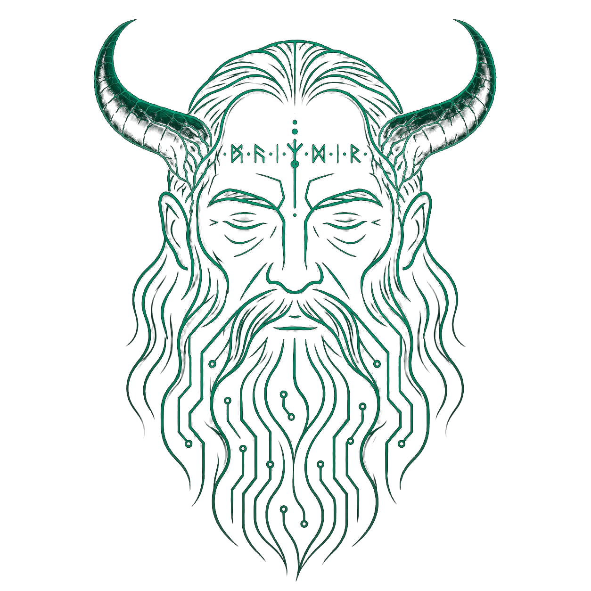

<p align="center">
  
</p>

<h1 align="center">MIMIR</h1>
<p align="center"><b>Gesture-Guided Surgical Intelligence</b> — a local desktop medical imaging workstation.</p>

---

MIMIR opens CT and MRI scans in DICOM format and lets you view them slice by slice, filter them, render them in 3D, and segment organs with AI. It runs entirely on your own machine as a desktop app: a small Python server does the imaging work and the app window shows the interface. No scan data is uploaded anywhere.

> [!WARNING]
> MIMIR is a research prototype. It is **not** a certified medical device and must not be used for clinical diagnosis or treatment decisions.

## Features

| Area | What it does |
|---|---|
| **DICOM viewer** | Opens a single DICOM file or a whole series folder (the first series found is loaded, including one level of subfolders). Shows patient info and lets you step through slices. |
| **Windowing** | Level and width sliders, with Brain, Lung and Bone presets. |
| **Filters** | Gaussian denoise, median, sharpen, CLAHE, unsharp mask, edge enhance and normalize, each with an adjustable strength. Filters only change the display; the scan data is never modified. |
| **3D view** | Builds a surface mesh with marching cubes on the server, then renders it in the app window with Three.js/WebGL. Has Bone, Soft Tissue and Skin presets and orbit, zoom and pan controls. |
| **AI segmentation** | Runs [TotalSegmentator](https://github.com/wasserth/TotalSegmentator) in Docker on the CPU (`--fast` mode) and draws up to 51 labelled organ and bone structures over the slices as a colour overlay. Opacity is adjustable and a legend lists the structures found. Uses the `total` task for CT and `total_mr` for MRI. |

**Planned:** The Register, Path Plan, Measure and Review tabs and the gesture camera panel are placeholders in the UI. They don't do anything yet.

## Download (Windows)

1. Download `MIMIR-Setup-x.y.z.exe` from the [latest release](https://github.com/KethanSaiV/mimir_web/releases/latest).
2. Run it. No admin rights are needed; MIMIR installs for your user only, with a Start-menu shortcut and an uninstaller.
   The installer isn't code-signed yet, so Windows SmartScreen may say "Windows protected your PC". Click **More info → Run anyway**.
3. Launch **MIMIR** from the Start menu. Closing the window quits the app.

Installing a newer version upgrades the existing one in place.

**AI segmentation needs [Docker Desktop](https://www.docker.com/products/docker-desktop/)**, installed and running. The first segmentation downloads the TotalSegmentator image (about 15 GB), and later runs reuse it. Everything else works without Docker.

Requirements: Windows 10 or 11 (64-bit), with the Edge WebView2 runtime, which comes with Windows. Segmentation needs about 4 GB of free RAM.

## Run from source (developers)

Requires **Python 3.10 – 3.12**.

```bash
git clone https://github.com/KethanSaiV/mimir_web.git
cd mimir_web

python -m venv venv
# Windows
venv\Scripts\activate
# macOS / Linux
source venv/bin/activate

pip install -r requirements.txt
```

Then start the app:

```bash
python server.py
```

The MIMIR window opens. The server listens on a free local port (`127.0.0.1` only). Closing the window stops it.

From source, segmentation uses Docker if it's installed. Otherwise it falls back to a local `pip install TotalSegmentator` in the same environment.

## Usage

1. Click **Open DICOM File** or **Open DICOM Folder** and choose a scan in the dialog that appears.
2. Use **Prev / Next** to move through slices, and the windowing sliders or presets to adjust contrast.
3. Open the **Filter** tab to apply an image filter.
4. Open the **3D View** tab to build a surface mesh, then pick an iso value or a preset.
5. Open the **Segment** tab and click **Run Segmentation**. On a typical CPU it takes a few minutes, and progress appears in the log. When it finishes, turn the overlay on and adjust its opacity.

## Releasing a new version

1. Bump `__version__` in `server.py`, using [semver](https://semver.org): patch (`0.1.1`) for fixes, minor (`0.2.0`) for new features.
2. Commit, then tag and push:
   ```bash
   git tag v0.1.1
   git push origin main v0.1.1
   ```
3. GitHub Actions builds `MIMIR-Setup-0.1.1.exe` and publishes the release, with notes generated from the commits since the last tag.

The build fails if the tag doesn't match `__version__`. To publish a test build first, use a tag with a suffix, such as `v0.2.0-rc.1`; it's marked as a pre-release.

To build the installer locally, install [Inno Setup 6](https://jrsoftware.org/isinfo.php), then:

```bash
pip install pyinstaller
pyinstaller server.py --name MIMIR --onedir --noconsole --noconfirm --add-data "static:static" --icon installer/mimir.ico --collect-submodules uvicorn
iscc /DAppVersion=0.1.1 installer\mimir.iss      # -> dist\MIMIR-Setup-0.1.1.exe
```

## Project structure

```
mimir_web/
├── server.py                # FastAPI app + native window (pywebview): routes, file dialogs, static hosting
├── state.py                 # Single in-memory workstation state (one user, one machine)
├── dicom_io.py              # DICOM file/series loading (pydicom + SimpleITK)
├── render.py                # Slice → PNG: windowing, filter, segmentation overlay
├── preprocessing_engine.py  # Display-time image filters
├── mesh3d.py                # Marching-cubes mesh extraction + binary serialization
├── segmentation.py          # TotalSegmentator runner, label map and overlay colours
├── requirements.txt
├── installer/               # Inno Setup script + app icon for the Windows installer
├── .github/workflows/       # release.yml: tag v* -> build installer -> GitHub Release
└── static/
    ├── index.html           # Single-page UI
    ├── assets/              # Logo
    └── vendor/              # Three.js r160, OrbitControls, GSAP 3.12.5, fonts (bundled, works offline)
```

## How it works

```
App window (index.html)  ──HTTP──▶  FastAPI (server.py, 127.0.0.1:<free port>)
   ▲  slice PNGs                       ├─ dicom_io      load volume into state
   │  mesh binary                      ├─ render        window + filter + overlay → PNG
   └─ WebGL renders mesh locally       ├─ mesh3d        marching cubes → vertices/normals/faces
                                       └─ segmentation  background thread → TotalSegmentator (Docker)
```

- **Single-user state.** The server keeps one volume and one set of settings in memory. It is designed for one person running it on their own machine, so it binds to `127.0.0.1` only.
- **Slices are rendered on the server.** Each slice is windowed, filtered and overlaid there, then sent to the window as a PNG.
- **3D meshes are built on the server and displayed in the window.** Volumes with any dimension over 220 voxels are downsampled first so marching cubes stays fast. The mesh is sent as a compact binary blob (vertex count, face count, then vertices, normals and indices), and your GPU renders it.
- **Segmentation runs in the background.** TotalSegmentator runs in a Docker container from a background thread. The UI checks `/api/segment/status` regularly to show progress.

## API reference

| Method | Endpoint | Description |
|---|---|---|
| `POST` | `/api/dicom/open-file` | Open the native file dialog and load the chosen file |
| `POST` | `/api/dicom/open-folder` | Open the native folder dialog and load the first series found |
| `GET`  | `/api/dicom/slice` | Current slice as a PNG |
| `POST` | `/api/dicom/nav` | `{delta}` or `{index}`: change the current slice |
| `POST` | `/api/dicom/window` | `{wl, ww}`: set window level and width |
| `GET`  | `/api/dicom/filters` | List the available filters and show the active one |
| `POST` | `/api/dicom/filter` | `{name, strength}`: set the filter (strength 0.1–2.0) |
| `GET`  | `/api/dicom/mesh-defaults` | Suggested iso value and slider range for the loaded modality |
| `GET`  | `/api/dicom/mesh?iso=&step=` | Binary surface mesh at the given iso value |
| `POST` | `/api/segment/run` | Start segmentation in the background |
| `GET`  | `/api/segment/status` | Segmentation progress log, errors and results |
| `GET`  | `/api/segment/legend` | Names and colours of the structures found |
| `POST` | `/api/segment/overlay` | `{show, opacity}`: control the segmentation overlay |
| `GET`  | `/api/status` | Overall workstation state |

FastAPI also generates interactive API docs at `/docs` on the app's local port (when running from source, find the port with `netstat -ano | findstr LISTENING`).

## Troubleshooting

- **The window is blank or won't open.** MIMIR needs the Microsoft Edge WebView2 runtime. It's built into Windows 10/11; if it was removed, reinstall it from Microsoft.
- **"Docker is installed but not running."** Start Docker Desktop, wait until it says it's running, then click Run Segmentation again.
- **Segmentation sits on "Downloading segmentation image".** The first run pulls about 15 GB. Later runs start immediately.
- **"No DICOM series found in that folder."** MIMIR checks the selected folder and one level of subfolders. Choose the folder that contains the `.dcm` files directly.
- **"No surface found at this threshold."** The iso value is outside the scan's intensity range. Try a preset or move the slider.
- **Segmentation is slow.** It runs on the CPU. A few minutes per volume is normal.

## Acknowledgements

[TotalSegmentator](https://github.com/wasserth/TotalSegmentator) · [SimpleITK](https://simpleitk.org) · [pydicom](https://pydicom.github.io) · [scikit-image](https://scikit-image.org) · [FastAPI](https://fastapi.tiangolo.com) · [Three.js](https://threejs.org) · [GSAP](https://gsap.com)

## License

No license has been chosen yet, so all rights are reserved by the author. TotalSegmentator and its model weights have their own license terms; check them before any commercial use.
